<p align="center">
  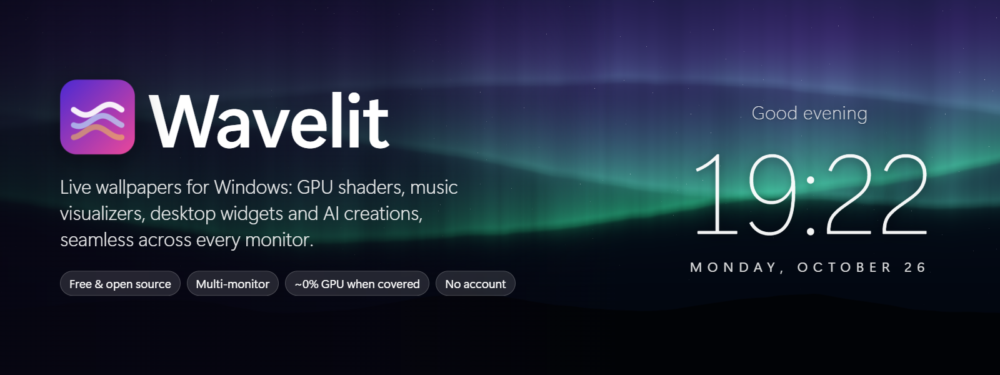
</p>

<p align="center">
  <a href="https://github.com/NDNathanRocks/WaveLit/actions/workflows/build.yml"></a>
  <a href="LICENSE"></a>
  
  
</p>

<p align="center"><b>Live wallpapers, music visualizers and desktop widgets for Windows, seamless across every monitor.</b><br>
Free and open source. No account, no telemetry, and ~0% GPU whenever you can't see it.</p>

---

## Why Wavelit

**One picture across all your screens, done properly.** Wavelit lines the wallpaper up with your real Windows display arrangement, whatever the size, resolution or orientation. It can compensate for bezels and different physical screen sizes, so a horizon stays straight from a 24" landscape monitor to a 27" portrait one. Every screen draws its own slice on a shared clock, so nothing tears or drifts.

<p align="center">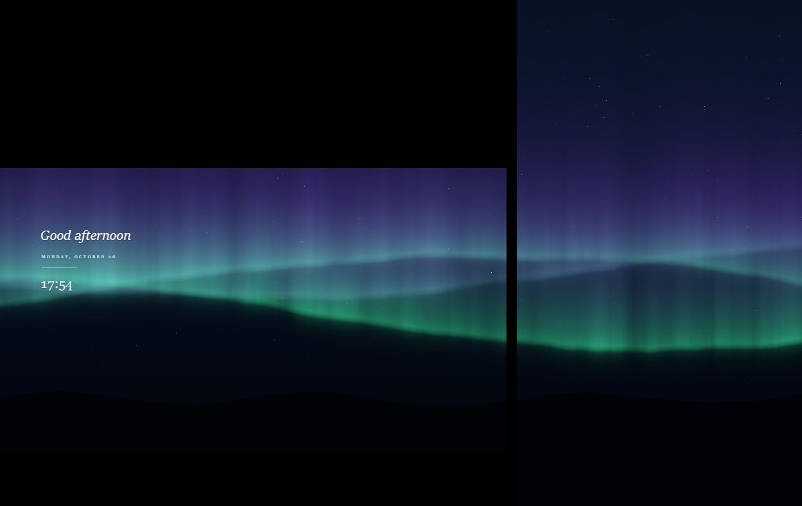</p>

**It gets out of your way.** Games, fullscreen apps, maximized windows, the lock screen, display sleep, battery saver and Remote Desktop all pause or suspend rendering automatically. Covered screens keep their last frame, so un-maximizing a window never flashes the old wallpaper.

## Features

| | |
|---|---|
| 🎵 **Music visualizers** | Synthwave Drive, Neon Bars and Resonant Stardust follow whatever your PC is playing (never the microphone), idle calmly in silence, and never flash. Any overlay can also move with the music. |
| ✨ **Overlays** | Stardust, fireflies, petals, snow, embers, aurora and more, layered over any wallpaper and reacting gently to your cursor. |
| 🕰️ **Desktop widgets** | A Rainmeter-style clock, date, greeting and title drawn right on the wallpaper, under your icons. Six themes, plus a drag-and-drop editor with snapping. |
| 🪟 **Taskbar** | Centred or left icons, and a clear, tinted, glass or acrylic taskbar through [TranslucentTB](https://github.com/TranslucentTB/TranslucentTB). Your own settings come back with one click. |
| 🤖 **Studio** | Describe a live wallpaper, overlay or visualizer and an AI writes it as a shader. Wavelit checks it for safety and speed on your own GPU before you see it, then gives you sliders to tweak it. Bring your own Claude key, use a free Cloudflare account, or paste from any chat AI. |
| 🖼️ **Create pictures** | Wallpapers shaped exactly like your screens, generated on your own GPU (private, unlimited) or in the cloud, then sharpened to full resolution. |
| 🌍 **Discover** | Wallhaven, NASA space videos and Openverse with no keys, plus Pixabay, Pexels and Shadertoy with free keys. Your own videos, images, web pages and Shadertoy-style shaders work too. |
| 🌗 **Smart** | Day and night wallpapers switched at your local sunrise and sunset, wallpapers remembered for each monitor setup, and seamless crossfaded video loops. |

<p align="center">
  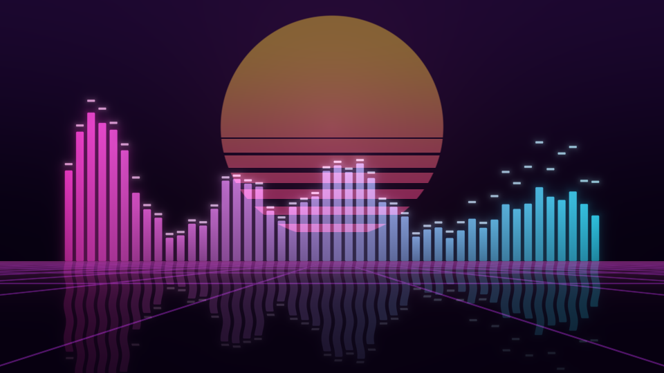
  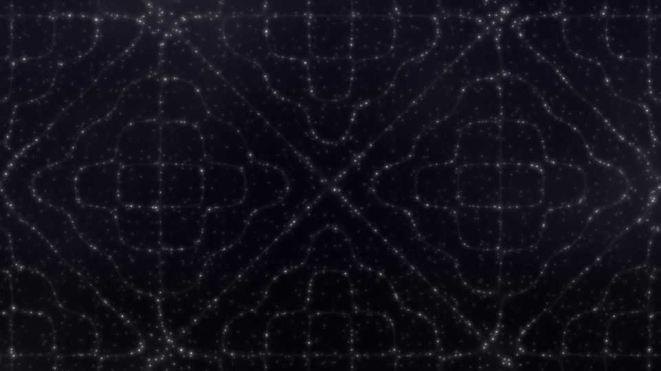
</p>

### Built-in wallpapers

<p align="center">
  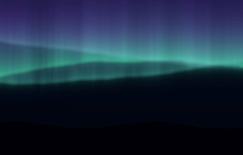
  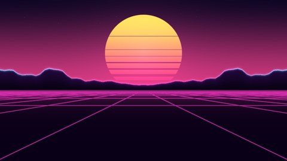
  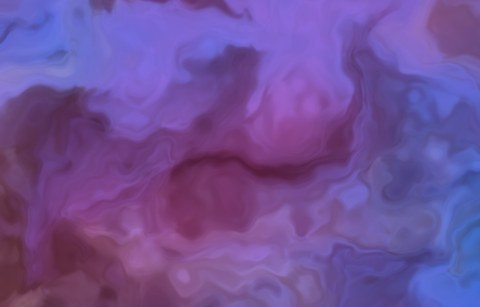
  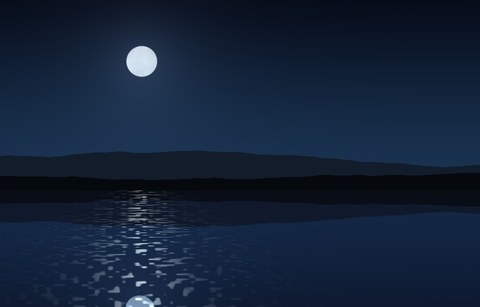
  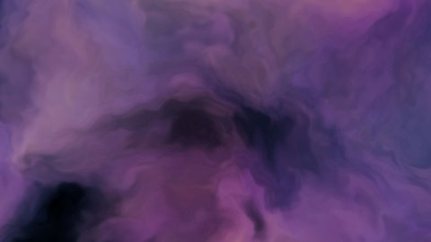
  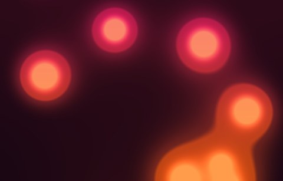
  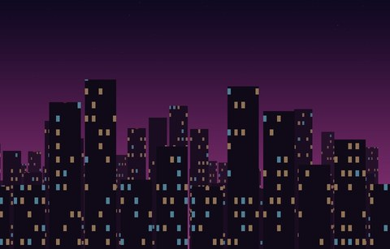
  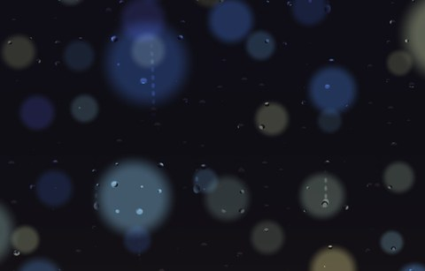
</p>

All 19 built-ins are original shaders written for Wavelit. They need no download and no key, and most cost under 0.1 ms per frame on a modern GPU.

## Install

| Option | For |
|---|---|
| **Microsoft Store** (coming soon) | One-click install, automatic updates, signed by Microsoft. |
| **Build from source** (below) | Developers. Free forever. |

> Windows 11 **Smart App Control** blocks unsigned programs. Source builds run fine with `dotnet Wavelit.dll`. The Store build is signed by Microsoft and is never blocked.

## Build from source

You need Windows 10 (2004 or later) or Windows 11, the [.NET 10 SDK](https://dotnet.microsoft.com/download), and the Microsoft Edge WebView2 Runtime (preinstalled on Windows 11).

```powershell
git clone https://github.com/NDNathanRocks/WaveLit.git
cd WaveLit
dotnet build Wavelit.sln -c Release
dotnet test tests/Wavelit.Core.Tests
dotnet src/Wavelit.App/bin/Release/net10.0-windows/Wavelit.dll
```

Every push is built and tested by GitHub Actions. Each run produces a portable build and an MSIX package (see `packaging/`).

| Switch | Effect |
|---|---|
| `--background` | Start in the tray without opening the dashboard (used by start-with-Windows). |
| `--quit` | Ask the running instance to exit cleanly. |
| `--verbose` | Debug-level logs, including every pause and resume decision. |
| `--frame-stats` | Log each wallpaper's frame rate, jitter and adaptive resolution. |
| `--soak` | Write resource usage to `logs/resources.csv` every minute (leak hunting). |
| `--no-wallpaper` | Dashboard only (UI debugging). |
| `--snapshot` | Save what every wallpaper window draws, laid out like your monitors, to `logs/snapshot.png`. |

Logs, settings and the cache live in `%LOCALAPPDATA%\Wavelit`.

## Optional free keys

Wavelit works without any key: the built-in wallpapers, visualizers and widgets, Wallhaven, NASA and Openverse, local AI, the Studio's copy-paste mode, and your own files.

- **Pixabay** (instant): sign up at [pixabay.com](https://pixabay.com/accounts/register/) and copy your key from [the API docs](https://pixabay.com/api/docs/). Paste it in *Settings → Pixabay videos*.
- **Cloudflare Workers AI** (free daily allowance): copy your Account ID and create an API token with the "Workers AI" template. Paste both in *Settings → Cloudflare*.
- **Anthropic** (best Studio results, billed to your own account): create a key at [console.anthropic.com](https://console.anthropic.com) and paste it in *Settings → Studio*.
- **Pexels** keys are paused by Pexels; existing keys still work. **Shadertoy** needs an account, or use *Library → Paste a shader*.

## How it works

Wavelit places a child window between the desktop wallpaper and the icons. This is the standard "WorkerW" technique, and it supports both the classic layout and the Windows 11 24H2+ layout. Each monitor's window hosts a WebView2 that plays video (hardware-decoded), runs a Shadertoy-compatible WebGL2 runtime, or shows a web page. A governor watches windows, display power, the lock screen and battery: covered screens freeze, then fully suspend. If frames start dropping, an adaptive guard lowers the resolution and recovers it later.

Privacy: [privacy policy](docs/privacy-policy.md). AI-made content is labelled "Made with AI" and can be reported from inside the app ([issues](https://github.com/NDNathanRocks/WaveLit/issues)).

## Credits and licenses

- Wavelit is licensed under the **GNU GPL v3** (see [LICENSE](LICENSE)). The Wavelit name and logo are not covered by the license.
- For third-party components and models, see [THIRD-PARTY-NOTICES.md](THIRD-PARTY-NOTICES.md). Online media belongs to its creators and is credited on every card.
- Built with [WPF-UI](https://github.com/lepoco/wpfui), [H.NotifyIcon](https://github.com/HavenDV/H.NotifyIcon), [CommunityToolkit.Mvvm](https://github.com/CommunityToolkit/dotnet), [VirtualizingWrapPanel](https://github.com/sbaeumlisberger/VirtualizingWrapPanel), [NAudio](https://github.com/naudio/NAudio), [Serilog](https://serilog.net) and Microsoft Edge WebView2. The see-through taskbar is powered by TranslucentTB, a separate app that Wavelit configures but doesn't bundle.

## Contributing

Issues and pull requests are welcome. Contributions are accepted under the GPL v3. Please run `dotnet test` before opening a pull request.
